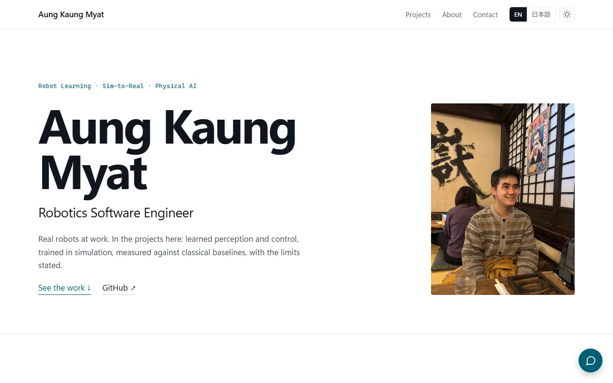

# AungKaung1928.github.io

Portfolio site: robot-learning projects in English and Japanese, each with a figure from its own repo and a small chat box. Live at https://aungkaung1928.github.io/



## Quick start

Requires Python 3 (local server) and Node (checks). No build step: plain HTML, CSS and JS.

```bash
git clone <this repo URL>
cd AungKaung1928.github.io
python3 -m http.server 8000      # open http://localhost:8000
node tools/check-kb.js && node tools/check-chat.js && node tools/check-links.js && node tools/check-contrast.js   # the checks CI runs
```

`check-links.js` reads `repos.json`, which CI writes from the GitHub API before deploy (`.github/workflows/pages.yml`).

## Layout

- `index.html`, `style.css`, `script.js`: home page (EN/JA toggle, light/dark).
- `projects/*.html`: one walkthrough per project.
- `chat.js`, `chat.css`: chat widget; `worker/` is the optional API proxy (see `worker/README.md`).

## License

No license file: the code and the photo are not licensed for reuse.
